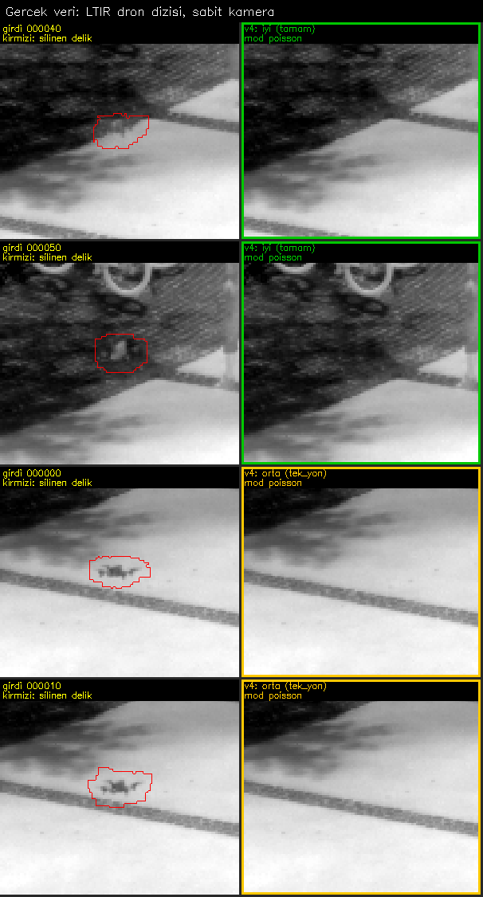
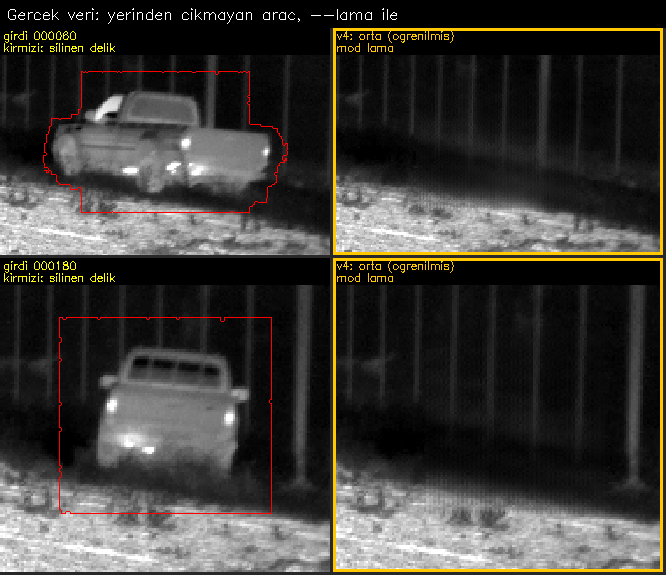
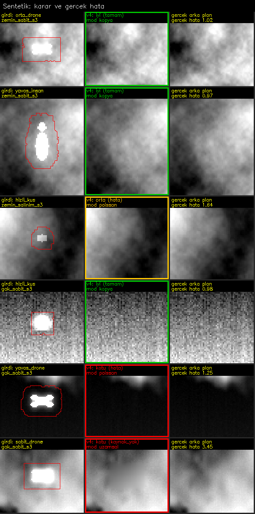

# a66: IR dizilerinden obje silme (v4)

`v4.py`, termal (IR) görüntü dizilerinde etiketli objeleri silip yerlerini arka planla doldurur ve her silme işlemine bir karar verir: **iyi**, **orta** ya da **kotu**. Her şey tek dosyada: ana program, sentetik test düzeneği, değerlendirme, kalibrasyon ve insan değerlendirme sayfası.

Tasarım [V4_UYGULAMA_GOREVI.md](V4_UYGULAMA_GOREVI.md) dokümanındaki göreve göre sıfırdan yazıldı.



## Ne yapar

1. **Kamera hizalama:** Kare çiftleri arasında benzerlik dönüşümü (öteleme, dönme, ölçek) hesaplanır. Özellik noktaları objelerden uzak seçilir. Dizi kendiliğinden `sabit` ya da `hareketli` sınıflanır.
2. **Kaynak bulma:** Objenin arkasındaki her piksel için o pikselin açık olduğu en yakın geçmiş ve gelecek kare bulunur. Kontrol hizalanmış koordinatta yapılır.
3. **Yerel hizalama:** Objenin çevresindeki halka artığı büyükse kaynak, obje çevresinde yeniden hizalanır (bulut kayması, birikmiş hizalama hatası).
4. **Delik inceltme:** Kutu objeden büyüktür. Kutunun içinde, bu karede zaten görünen gerçek arka plan korunur; yalnız objenin kendisi ve halesi silinir.
5. **Dolgu:** Gerçek piksel taşınır. Hizalama ve parlaklık uyuyorsa birebir kopya (`kopya`), uymuyorsa gradyan alanında birleştirme (`poisson`). Hiç açılmayan piksel için isteğe bağlı öğrenilmiş dolgu (`lama`); o da yoksa harmonik dolgu (`uzamsal`, her zaman `kotu`). Sentetik gürültü hiç eklenmez.
6. **Karar:** Kanıt objenin kendi yerinden ve yazılan son piksellerden gelir:
   - `a1`: aynı kaynak deliğin hemen yanında ne kadar yanılıyor
   - `a2`: dolgu, zamanın öbür yanındaki bağımsız görüntüyle ne kadar uyuşuyor
   - `leftover`: delik dışında kalan obje/hale
   - `seam`: kenar başına en kötü basamak
   - `texture`: ince doku uyumu
   - `flicker`: ardışık kareler arası titreme

   Birim gürültü katıdır: kusursuz kopya ≈ 1. Kararın nedeni de yazılır (`tamam`, `hata`, `tek_yon`, `dikis`, `doku`, `kalinti`, `kaynak_yok`, `ogrenilmis`, `titreme`, `cok_buyuk`).

## Kullanım

```bash
pip install numpy opencv-python scipy
python v4.py --project "C:\proje" --out "C:\cikti" --preview-every 20
```

Öğrenilmiş dolguyla (torch gerekir, model Git LFS ile depoda):

```bash
git lfs install
python v4.py --project "C:\proje" --out "C:\cikti" --lama models/ir_lama.pt
```

**Girdi:** `--project` kökünde `2_Etiketlenecek_Veri/tif/*.tiff` ve `3_Etiketlenmis_Veri_Ciktisi/coco-images.json`, `coco-annotations.json`. Ya da `--frames` ile birlikte `--labels` (YOLO klasörü veya `frame,x,y,w,h` CSV).

- 8 ve 16 bit korunur; delik dışındaki pikseller birebir aynı kalır.
- Etiket kaydı olmayan kare işlenmez ve kaynak olarak kullanılmaz.
- Kayıtlı ama objesiz kare olduğu gibi `iyi/`'ye kopyalanır.

| Seçenek | Varsayılan | Anlam |
|---|---|---|
| `--camera` | `auto` | `auto`, `static`, `moving` |
| `--search` | `1000` | Kaynağın en çok uzaklığı (kare) |
| `--margin` | `3` | Obje çıktıktan sonra beklenecek kare (ısıl iz) |
| `--box-pad` | `auto` | Kutu payı; auto = boyutun %25'i, 4-10 piksel |
| `--thresholds` | `1.4,2.5` | `iyi` ve `kotu` eşikleri (`e_hat`) |
| `--visible-fraction` | `0.005` | Görünmez sayılan hata payı (dizinin parlaklık aralığına oranla) |
| `--lama`, `--lama-device` | – , `cuda` | Öğrenilmiş dolgu |
| `--every` | `1` | Yalnız her N. kareyi işle (kaynak olarak hepsi kullanılır) |
| `--workers` | `4` | Süreç sayısı |
| `--preview-every` | `0` | Her N karede bir önizleme |

**Çıktı:**

| Yol | İçerik |
|---|---|
| `iyi/`, `orta/`, `kotu/` | `bg_<ad>`: temizlenmiş kare. Klasörü, karedeki en kötü objenin kararı belirler |
| `guven/` | Piksel düzeyinde güven: 255 dokunulmadı, 200 iyi dolgu, 128 orta, 0 kötü. Tek kötü obje yüzünden kare çöpe gitmesin diye |
| `onizleme/` | Solda girdi ve silinen delik (renk = karar, yazı = mod ve neden), sağda sonuç |
| `rapor.csv` | Obje başına tüm sinyaller, karar ve neden |
| `hizalama.csv`, `ozet.json` | Kare çifti dönüşümleri; dizi bilgileri, sayılar, süre |

Araçlar aynı dosyada:

```bash
python v4.py sentez --out KLASOR --scene zemin --camera salinim --frames 600 --seed 3
python v4.py degerlendir --bench KLASOR --run CIKTI
python v4.py kalibre --pairs BENCH1:RUN1 BENCH2:RUN2 --out kalibrasyon.json
python v4.py sayfa --run CIKTI --frames KARELER --count 150 --out SAYFA
python v4.py uyum --sheet SAYFA
```

`sayfa`, kararı göstermeden 150 örnek üretir. Sen `puanlar.csv`'yi iyi/orta/kotu diye doldurursun, `uyum` script ile senin kararını karşılaştırır.

## Görseller

**Gerçek veri, öğrenilmiş dolgu:** araç bölgeden hiç çıkmıyor, arka plan hiçbir karede görünmüyor. `--lama` ile dolduruluyor; doğrulanamadığı için en fazla `orta`.



**Sentetik, gerçek arka planı bilinen dizi:** solda girdi, ortada v4 ve kararı, sağda gerçek arka plan ve gerçek hata.



Tam kare önizlemeler: [dron 150](gorseller/onizleme_dron_000150.png), [dron 270](gorseller/onizleme_dron_000270.png), [sentetik zemin](gorseller/onizleme_zemin_sabit.png), [sentetik gök](gorseller/onizleme_gok_sabit.png).

## Ölçülen sonuçlar

Sentetik düzenek: 600 kare, 640×512, 16 bit, gerçek arka plan biliniyor. Sahneler `zemin` (dokulu, durağan), `gok` (sürüklenen ve biçim değiştiren bulut), `karma`. Objeler:

| Obje | Hız (piksel/kare) |
|---|---|
| hızlı kuş | 3,2 |
| orta dron | 1,0 |
| yavaş dron | 0,23 |
| çok yavaş dron | 0,10 |
| sabit dron | 0 |
| yavaş insan | 0,30 |

Kamera hareketleri: sabit, salınım ±12 piksel, pan 0,27 piksel/kare, dönme ±1°, zoom ±%2, hızlı salınım ±38 piksel.

Ölçüm yöntemi:
- Gerçek hata `e_true` = sonucun gerçek arka plandan farkı / gürültü (1,0 ≈ başka kareden kusursuz kopya).
- Gerçek iyi: `e_true` ≤ 1,6. Gerçek kötü: `e_true` > 3.
- Kabul ölçümü **tohum 3 ve 4**'te yapıldı; ayar ve kalibrasyon yalnız tohum 1'de.
- Her 5. kare işlendi (`--every 5`), kaynak olarak tüm kareler kullanıldı. `--visible-fraction 0` (en katı durum).

### Kararın dürüstlüğü (zorunlu ölçütler)

| Koşul | Q1 P(gerçek kötü \| karar iyi) ≤ 0,03 | Q2 P(gerçek iyi değil \| karar iyi) ≤ 0,15 | Q3 P(karar kotu \| gerçek kötü) ≥ 0,75 | Q4 P(karar iyi \| gerçek kötü) ≤ 0,07 | Spearman | Q6 sabit dron `kotu` |
|---|---|---|---|---|---|---|
| A zemin, sabit kamera | 0,000 (0/634) ✅ | 0,000 (0/634) ✅ | 1,000 (323/323) ✅ | 0,000 ✅ | – | %100 ✅ |
| B zemin, salınım | 0,000 (0/175) ✅ | **0,771 (135/175) ❌** | 0,860 ✅ | 0,000 ✅ | – | %100 ✅ |
| B zemin, pan | 0,000 (0/154) ✅ | **0,474 (73/154) ❌** | 0,965 ✅ | 0,000 ✅ | – | %100 ✅ |
| B zemin, dönme | ölçülemedi (0/17) | ölçülemedi (2/17) | 0,973 ✅ | 0,000 ✅ | – | %100 ✅ |
| B zemin, zoom | 0,000 (0/22) ✅ | 0,091 (2/22) ✅ | 0,971 ✅ | 0,000 ✅ | – | %100 ✅ |
| B zemin, hızlı salınım | 0,000 (0/415) ✅ | **0,783 (325/415) ❌** | 0,852 ✅ | 0,000 ✅ | – | %100 ✅ |
| C gök + karma, sabit | 0,000 (0/482) ✅ | 0,000 (0/482) ✅ | 1,000 (1002/1002) ✅ | 0,000 ✅ | **0,76** ✅ (≥ 0,60) | %100 ✅ |
| D gök, salınım (rapor) | 0,000 (0/261) | 0,011 (3/261) | 1,000 | 0,000 | 0,72 | %100 |

- **Q1 her koşulda 0:** v4, gerçekten kötü bir dolguya hiçbir koşulda "iyi" demedi.
- **Q2 hareketli kameralı zeminde kalıyor:** "iyi" denen dolguların bir kısmı gerçek hatası 1,6–3 arası, yani sınırda (kötü değil). Paydası 20'den küçük oranlar "ölçülemedi" yazıldı, geçti sayılmadı.

### Dolgu kalitesi (gerçek hata medyanı)

| Obje | A zemin sabit | B salınım | B pan | B dönme | B zoom | B hızlı | C gök+karma | D gök salınım |
|---|---|---|---|---|---|---|---|---|
| hızlı kuş | **1,03** (%73 iyi) | 2,01 | 1,64 | 1,87 | 1,87 | 1,84 | 1,12 | 1,17 |
| orta dron | **1,02** (%83 iyi) | 1,97 | 1,75 | 1,92 | 1,91 | 1,86 | 1,19 | 1,18 |
| yavaş dron | 1,01 (%46 iyi) | 2,01 | 1,81 | 1,94 | 2,01 | 1,90 | 3,89 (%91 kotu) | 2,17 |
| yavaş insan | 1,00 (%62 iyi) | 2,18 | 2,02 | 2,08 | 2,20 | 2,24 | 0,99 | – |
| çok yavaş dron | 1,03 (%61 kotu) | 2,77 | 2,28 | 2,58 | 2,62 | 2,42 | 5,87 (%100 kotu) | 4,69 |
| sabit dron | 12,9 (%100 kotu) | 13,2 | 13,7 | 13,9 | 13,1 | 13,2 | 3,46 | 5,53 |

| Hedef | Ölçülen | Sınır | |
|---|---|---|---|
| F1 A hızlı kuş / orta dron | medyan 1,03 / 1,02; iyi %73 / %83 | ≤ 1,15 ve ≥ %95 iyi | ❌ (kalite tuttu, iyi oranı tutmadı) |
| F2 A yavaş dron / yavaş insan | medyan 1,01 / 1,00; iyi %46 / %62 | ≤ 1,2 ve ≥ %50 iyi | ❌ / ✅ |
| F3 B salınım, pan, dönme, zoom (hızlı + orta) | medyan 1,87 | ≤ 1,8 | ❌ (kıl payı) |
| F4 B hızlı salınım (hızlı + orta) | medyan 1,85 | ≤ 2,2 | ✅ |
| Hız | en çok 0,55 sn / obje / süreç | ≤ 1,0 | ✅ |

### Ne anlama geliyor

- **Sabit kamerada dolgu kusursuza yakın** (medyan 1,0–1,03). Kararlar temkinli: gerçekten iyi dolguların bir kısmı `orta`.
  - En büyük sebep `tek_yon`: arka plan zamanın yalnız bir yönünden açılmış, çapraz doğrulama yok (dizi başı ve sonu, yavaş objeler).
  - Ardından `dikis` ve `doku` yanlış alarmları. `dikis`in bir kısmı, sentetik objenin halesinin varsayılan kutu payından 1 piksel taşmasından geliyor.
- **Hareketli kamerada (dokulu zemin) dolgu ~2 gürültü katına çıkıyor.** Kaynak pikseller en yakın piksele yuvarlanarak taşınıyor (gürültüyü korumak için bilinçli kural); alt piksel kaymada dokulu yüzeyde bu hata veriyor. Aynı sebeple gürültü kestirimi şişiyor (5,5 yerine 6–11), karar gevşiyor ve Q2 kalıyor.
- **Değişen bulut önünde yavaş obje** bu yaklaşımın bilinen sınırı. Dolgu iyi değil (3–6), ama karar bunu doğru söylüyor: %91–100 `kotu`.
- **Kalibrasyon aracı** (tohum 1'de) eşiği gevşetti: T_IYI 2,0, KAPPA 0,5. Aracın kısıtı yalnız Q1 ve Q3 olduğu için Q2'yi 0,34'e kötüleştirdi. Bu yüzden **varsayılan eşikler kullanıldı**; kalibrasyon sonucu raporda.

## Testler

```bash
python -m pytest test_v4.py -q
```

15 test, hepsi geçiyor:
- 8/16 bit gidiş-dönüş; paketli 14 bit TIFF reddi; Türkçe karakterli yol
- Delik dışının dokunulmazlığı
- COCO, YOLO ve CSV'nin bayt bayt aynı çıktısı
- Bilinmeyen ve boş kare
- Kopyanın gerçek kaynak pikselleri olması
- `--workers 1` ve `4` ile bayt bayt aynı çıktı; `--every`
- Kenardaki kutu
- Kıpırdamayan obje ve sahte lama modeli
- 3 ve 4 kanal
- Kamera pan ve dönme
- Karar sınırları
- Kusur ekleme: kaydırma, aynalama, bulanıklaştırma, harmonik dolgu, parlaklık kayması, dışarıda kalan hale, yabancı içerik. Her biri kararı `iyi`den düşürüyor.

Testler küçük sentetik dizileri kendileri üretir; dış veri gerekmez.

## Model

`models/ir_lama.pt`: big-lama (LaMa, Apache-2.0) üzerine IR görüntülerle ince ayar yapılmış inpainting modeli. TorchScript, 206 MB, Git LFS.

- **Eğitim:** LLVIP, LTIR ve AAU RainSnow'dan 24.267 eğitim / 8.029 doğrulama çifti; 6000 adım, batch 4, öğrenme oranı 1e-5. Ayrıntılar `models/ir_lama.json`'da.
- **Sonuç:** Doğrulama hatası (maske içi normalize L1) 0,0740 → 0,0606 (%18 daha iyi).
- **Sınırı:** Sokak ve yaya sahneleriyle eğitildi, gökyüzünde güvenilmez. v4'te yalnız hiç açılmayan pikseller için kullanılır ve en fazla `orta` alır.

## Bilinen sınırlar ve açık noktalar

- **Q2 hareketli kamerada tutmuyor** (yukarıda). Kökü: en yakın piksel örnekleme ve dokulu sahnede gürültü kestiriminin şişmesi. Görev dokümanının kuralı gereği algoritma değiştirilmedi, tanı olarak raporlandı.
- **Kutu payı** (boyutun %25'i, 4–10 piksel) güçlü halesi olan objelerde dar kalabiliyor; `--box-pad` ile artırılabilir.
- **Gürültü kestirimi** sabit sahnede ~%5 düşük çıkıyor (5,24 / 5,5); `a1`, `a2` tipik olarak 1,05 civarında. Test 5 bu yüzden medyanlara uygulandı.
- **Kapsam dışı:** Paralaks (yakın yapının önünde ötelenen kamera), yarı saydam buhar, sabit desen gürültüsünün ayrıştırılması.
- **Gerçek veri:** Yalnız iki LTIR dizisinde denendi (görseller). Kendi dizilerinde `sayfa` + `uyum` ile insan doğrulaması önerilir.
- **Sapmalar:** Tohum 2 kullanılmadı, ayar yalnız tohum 1'de. Değerlendirmede, ölçüm penceresine giren komşu objelerin pikselleri hataya sayılmadı (`# KARAR` olarak kodda).
